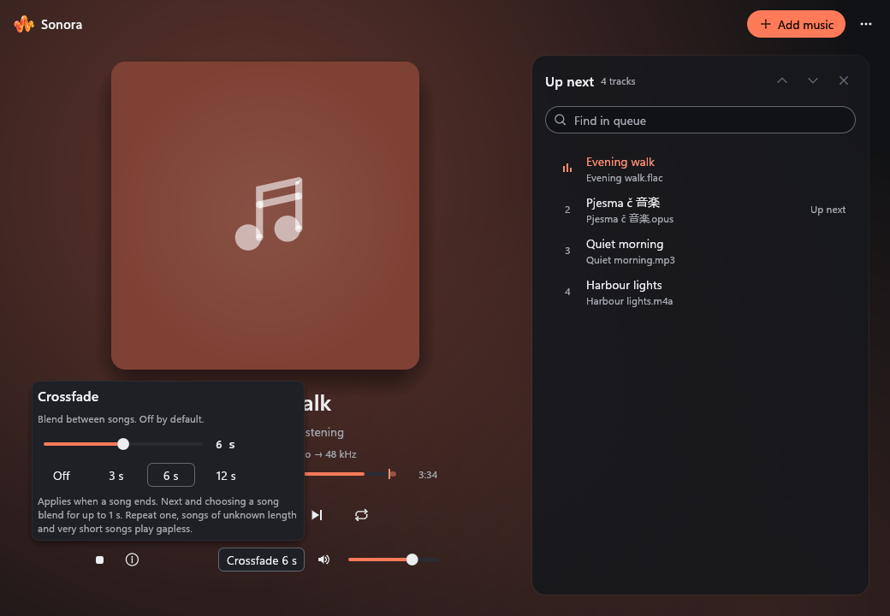

# Sonora

## A native music player for Windows

Play your local music with a clear queue, remembered crossfade and Windows media controls.

[Sonora downloads](https://github.com/v2matosevic/Sonora/releases/latest) · [Install](docs/INSTALL.md)
· [User guide](docs/USER-GUIDE.md) · [Formats](docs/FORMATS.md)
· [Build](docs/BUILD.md) · [Verification](docs/VERIFICATION.md)

## Features

- Local MP3, WAV, FLAC, AAC/M4A, ALAC, Vorbis, Opus and AIFF playback.
- Crossfade from off to 12 seconds, shuffle/repeat and playlists.
- Artwork, playback/source details and native Windows media-session controls.
- Bounded streaming playback, offline operation and light/dark/system themes.

## Requirements

Windows 10/11 x64 and an OpenGL-capable graphics driver. Development verification used Windows 11.
Download Sonora-0.2.1-Setup.exe or its portable ZIP. Installation is per-user and needs no admin
account. No accounts, Electron, telemetry or background service. Installers preserve default apps.
Builds are currently unsigned; checksum and update instructions are in the installation guide.

## License and contributing

First-party code and original artwork are MIT licensed. Dependencies retain their licenses. [License](LICENSE) · [Third-party terms](docs/LICENSING.md).
This is an independent app and repository. Its shared UI source is included locally, so building
or using Sonora does not require another app repository. Publisher: Version2.
[Contributing](CONTRIBUTING.md) · [Security](SECURITY.md).

The screenshot is actual application UI with generated demonstration media. See verification for
the checks performed and remaining hardware, physical-input and perceptual limits.
