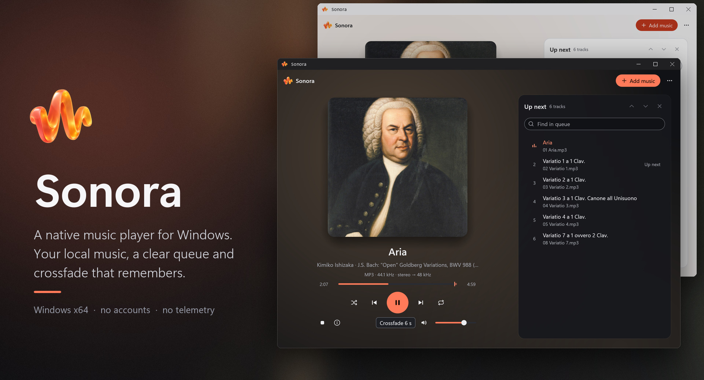
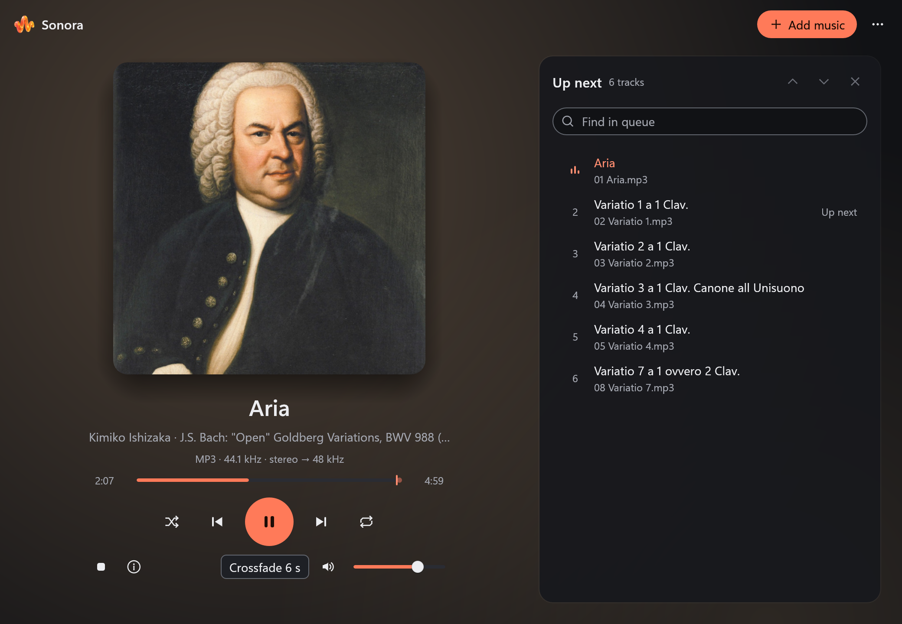
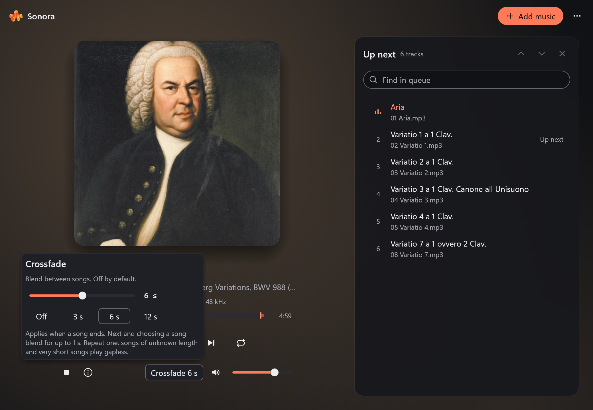
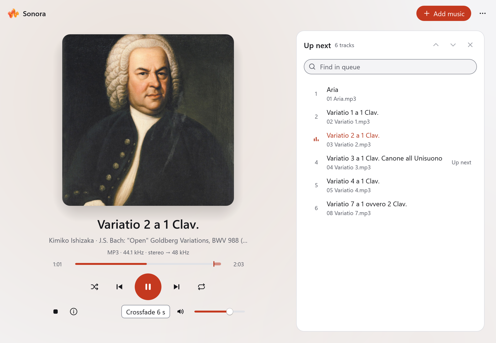

  

Sonora is a native music player for Windows. It plays the files you already own, shows a clear
queue, remembers your crossfade, and connects to the Windows media controls. No account, no telemetry, no
background service, nothing to sign in to.

**[Download Sonora 0.2.1](https://github.com/v2matosevic/Sonora/releases/latest)** (installer 3.3 MB)
· [Install](docs/INSTALL.md) · [User guide](docs/USER-GUIDE.md) · [Formats](docs/FORMATS.md)
· [Build](docs/BUILD.md) · [Verification](docs/VERIFICATION.md)

The picture above is a mockup built from the scenes below. Every picture, and the music and
artwork behind it, is explained in [docs/MEDIA-CREDITS.md](docs/MEDIA-CREDITS.md).

## What it does

- Plays local MP3, WAV, FLAC, AAC/M4A, ALAC, Ogg Vorbis, Opus and AIFF files.
- Crossfades from off to 12 seconds, and remembers the length you chose.
- Keeps a queue you can search and reorder, plus shuffle, repeat and playlists.
- Shows the embedded cover and the real source and output format of what is playing.
- Connects to the Windows media controls, and comes in light, dark or follow-Windows themes.
- Streams files in bounded memory and runs fully offline.

## Install in a minute

1. Download `Sonora-0.2.1-Setup.exe` from the [latest release](https://github.com/v2matosevic/Sonora/releases/latest).
2. Run it. Sonora installs for your user only, needs no administrator account and appears in Start under Version2.
3. Choose Add music, or drag files onto the window. The Open with option is off unless you tick it.

Prefer no installer? Download the portable ZIP (6.0 MB), extract every file into a fresh folder and
run `sonora.exe`. The builds are unsigned, so compare the download with `SHA256SUMS.txt` first:
`Get-FileHash -Algorithm SHA256 <file>`. More in the [installation guide](docs/INSTALL.md).

Windows 10 or 11 on x64 with an OpenGL-capable graphics driver. Development verification used Windows 11.

## A look inside

These are scenes drawn by Sonora's own interface from real files: the title, artist, album, length,
format and cover come from the files themselves. The playback position and crossfade state are
staged, because a still picture cannot hold a running player. They are not photographs of a running
window. The recording is Kimiko Ishizaka's CC0 *Open Goldberg Variations*, and the cover is Haussmann's 1748
portrait of Bach, public domain; neither is the album's own artwork. Credits and licenses are in
[docs/MEDIA-CREDITS.md](docs/MEDIA-CREDITS.md).

Now playing. Six songs in the queue, the next one tagged "Up next", and a mark near the end of the
seek bar where the crossfade will begin.

The crossfade panel. It is off by default, goes up to 12 seconds, and the choice is remembered.

Two songs overlapping. The chip counts down the blend and the queue tags the song that is fading out.

The light theme. Dark, light and follow-Windows are in the More menu.

## Formats and limits

MP3, WAV/PCM, FLAC, AAC/M4A, ALAC, Ogg Vorbis, Opus and AIFF are covered; rare layouts and profiles
are conditional. Windows shared-mode output does not promise bit-perfect sound, and AAC/M4A encoder
padding can affect gapless playback. Details are in [docs/FORMATS.md](docs/FORMATS.md). Checks that
were run, and what was not tested (physical media keys, long listening, other graphics hardware),
are in [docs/VERIFICATION.md](docs/VERIFICATION.md).

## License and contributing

First-party code and original artwork are MIT licensed. Dependencies retain their licenses
([License](LICENSE), [third-party terms](docs/LICENSING.md)). Music and pictures used in the README
keep their own terms ([media credits](docs/MEDIA-CREDITS.md)). Sonora is an independent app and
repository: its shared interface source is included here, so building it needs no other repository.
Publisher: Version2. [Contributing](CONTRIBUTING.md) · [Security](SECURITY.md).
